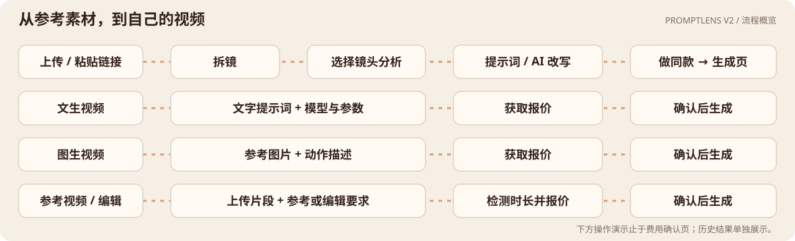
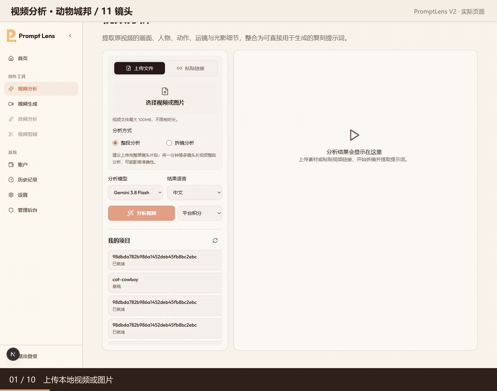
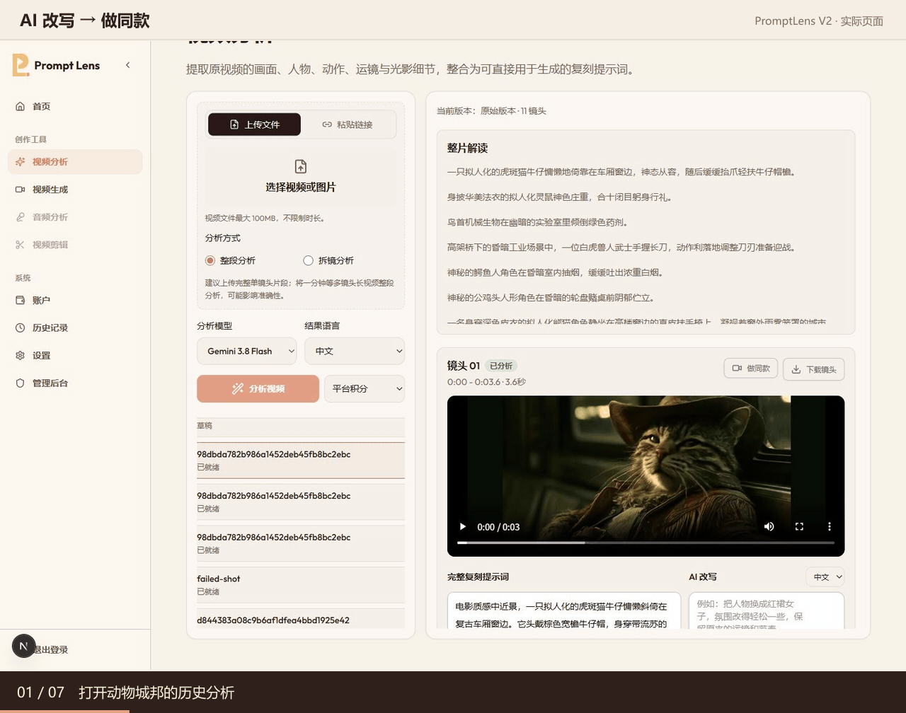
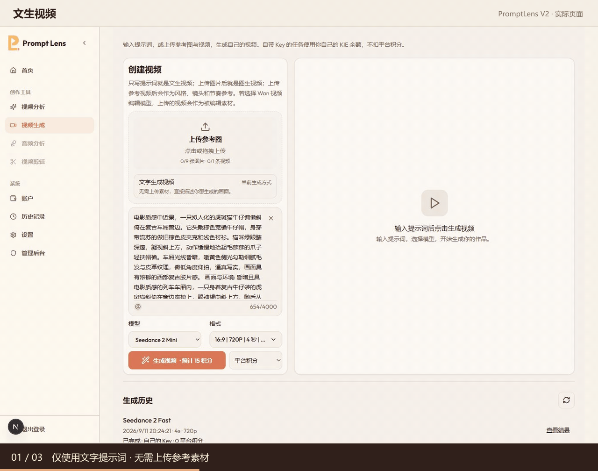
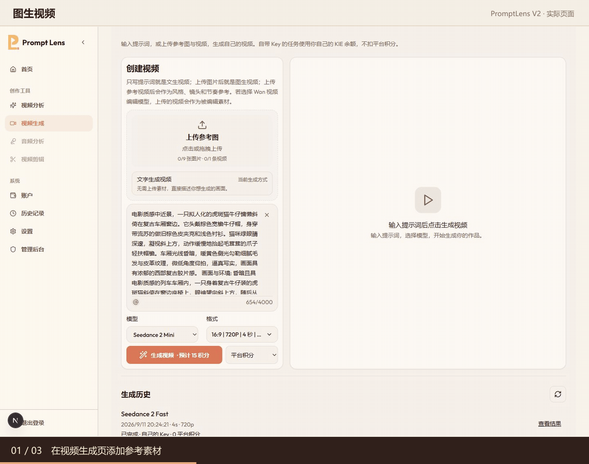
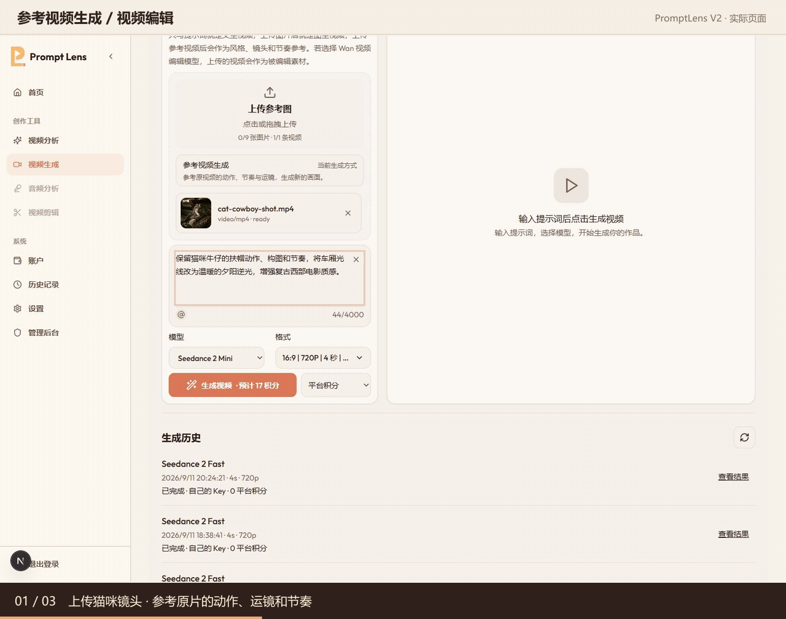
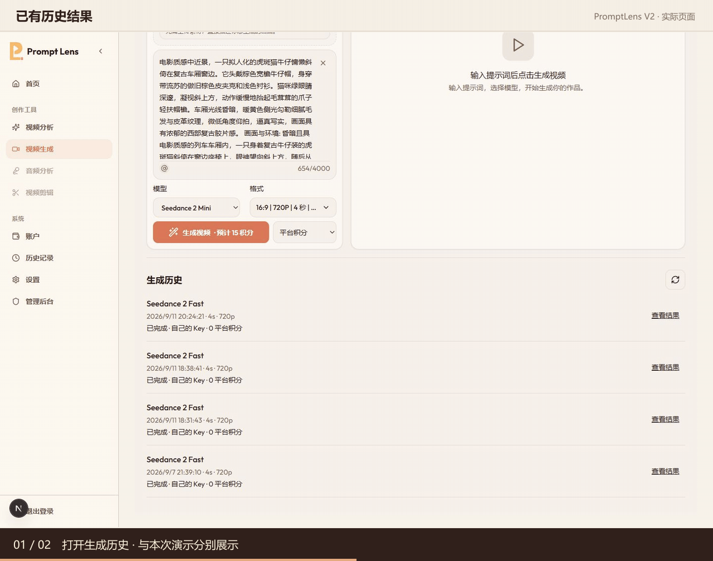

# PromptLens V2

PromptLens V2 是一个 AI 视频创作工作流工具，将参考视频或图片整理成可编辑的画面分析和复刻提示词，帮助你理解镜头、改写创意并生成自己的视频。

## 功能概览

- **参考素材分析**：上传视频、图片，或粘贴 TikTok、抖音、Bilibili 公开视频链接。
- **自动拆镜**：检测画面切换，生成带时间范围的镜头列表，支持预览和选择要分析的镜头。
- **逐镜头解读**：分析主体、角色、环境、动作、构图、运镜、光线、色彩和画面风格。
- **复刻提示词**：将画面信息整理成可复制、可编辑的视频生成提示词。
- **AI 改写与版本回看**：按文字要求修改单个镜头，保留版本，便于比较和继续调整。
- **做同款与视频生成**：将分析出的提示词带入生成页，支持文生视频、图生视频、参考视频生成和视频编辑。
- **项目与历史记录**：保存分析结果与生成记录；失败镜头可单独重试，已完成的镜头保留。

## V2 操作演示

以公开样例「动物城邦」为素材：约 27 秒、11 个镜头。动图录制于 2026-10-11，来自实际页面操作，已缩短等待时间。分析部分展示已有项目结果，视频生成部分展示参数设置，未提交新的生成任务。当前界面细节可能与录制时有所不同。



### 视频分析：上传或粘贴链接 → 拆镜 → 选择镜头 → 提示词

展示素材输入、11 个镜头的预览与选择，以及完整分析结果和复刻提示词。



### AI 改写与做同款

输入修改要求，查看改写版本并回看原版；点击「做同款」将当前提示词带入生成页。



### 文生视频

填写提示词，选择模型、画幅、分辨率、时长和数量。



### 图生视频

上传参考图片，页面自动切换为图生视频，再结合提示词设置生成参数。



### 参考视频生成与视频编辑

上传参考片段，描述希望保留或修改的动作、场景和运镜。选择支持视频编辑的模型时，上传片段会作为被编辑素材。



<details>
<summary>查看已有生成历史</summary>

展示已有生成记录、提示词与结果查看入口。生成的视频建议及时下载保存，历史媒体链接可能失效。



</details>

## 从参考素材到新视频

```text
上传视频 / 图片，或粘贴视频链接
                ↓
        保存素材并创建项目
                ↓
  视频：自动拆镜或作为整段分析
  图片：作为单场景参考图
                ↓
     选择镜头，准备分析素材
                ↓
     AI 分析 → 结构化画面信息
                ↓
       复刻提示词与改写版本
                ↓
     复制使用，或进入视频生成
```

视频链接解析使用 EasyDown。

## 自动拆镜的技术实现

拆镜由独立的媒体 worker 执行，主要使用 FFmpeg、ffprobe 和 PySceneDetect。Next.js 负责页面、项目管理和任务协调，媒体 worker 负责视频解码、镜头边界检测及素材提取。

### 1. 检查素材与视频流

本地上传和链接导入的视频保存后，会进入同一套视频预处理与逐镜头分析流程。worker 使用 `ffprobe` 读取时长、分辨率、帧率和音轨，并尝试解码真实画面，确认视频流可用。仅能读出分辨率不足以证明视频可以正常处理。

不支持的编码、无法解码的画面或损坏的视频会返回错误，避免将检测失败误当成「整段只有一个镜头」。

### 2. 检测画面切换

默认使用 **PySceneDetect 的 AdaptiveDetector**。它结合相邻帧的内容变化及附近帧的变化水平判断切点，适应不同片段的运动强度。检测结果是一组时间边界，用于把视频划分成连续区间。

当前默认参数：

| 参数 | 默认值 | 用途 |
| --- | --- | --- |
| 自适应阈值 | 3.0 | 控制画面变化达到什么程度时成为切点候选 |
| 最小内容变化值 | 15.0 | 过滤变化幅度较小的候选 |
| 邻域窗口 | 前后各 2 帧 | 提供局部变化水平作为比较依据 |
| 最小镜头间隔 | 0.6 秒 | 限制过于密集的切点 |

PySceneDetect 未启用或运行失败时，worker 回退到 **FFmpeg 的 scene filter**，默认阈值为 `0.32`。两种检测方式都失败时会报告拆镜失败；正常完成检测但没有发现切点时，视频可以作为一个连续片段继续处理。

### 3. 处理过长的连续片段

镜头边界检测后，还会进行时长检查：

- **15 秒以内的区间保留原有边界**。
- 超过 15 秒的区间继续细分，尽量让每段落在 **8–10 秒**。
- 无法按 8–10 秒完整覆盖时，围绕可行的平均长度分配时长，保持每段不超过 15 秒，避免留下很短的尾段。
- 分段连续覆盖原区间；预览流程以源文件哈希作为种子，分段结果保存后，素材提取沿用同一组时间范围。

这一步用于控制单次分析的素材长度。新增的时间边界可能位于同一个连续镜头内，不能等同于检测到了新的剪辑切点。

### 4. 预览、选择与素材提取

先返回镜头编号及起止时间，供用户预览和选择；正式分析时按已保存的时间范围提取所选镜头素材：

- **视频片段**：按区间切出，分析流程中的片段编码为 H.264，存在音轨时使用 AAC。
- **代表帧**：在每段约 **10%、50%、90%** 的位置各提取一张 JPEG，覆盖片段前、中、后的画面。
- **音频**：存在音轨时尝试提取对应片段，供音频相关处理使用。

素材保存在 Cloudflare R2，后续分析复用这些资源。这里的三张代表帧是按时间采样的画面，与视频编码中的 I 帧概念不同。

### 5. 独立分析每个镜头

所选镜头分别进入独立任务，可以并行分析，无需等待上一镜头的完整模型回答。模型主要接收三张代表帧、镜头编号和时间范围，输出结构化画面描述及复刻提示词；没有代表帧时才使用镜头视频作为视觉输入。

服务端检查 `story`、`visual`、`generationPrompt` 等结果字段，再保存分析内容。已完成镜头会陆续返回，页面按镜头编号展示，因此完成顺序可能与视频顺序不同。模型回答会先保存检查点，便于在后续写入暂时失败时恢复；失败镜头保留状态，可单独重试。

### 适用范围与局限

- 自动拆镜适合包含多个画面切换的视频；整段分析适合完整的单镜头片段。
- 快速运镜、闪光、渐变转场或变化很小的剪辑可能造成误切或漏切，检测结果仍需结合预览判断。
- 三帧采样提供主要视觉参考，可能遗漏采样点之间的短暂动作。分析内容和提示词适合继续编辑与校正。
- 媒体处理与模型分析是不同阶段：成功拆出镜头后，模型调用仍可能受到服务可用性和网络状况影响。

相关实现：[镜头检测](workers/ffmpeg-worker/scene-detect.py)、[长片段分段与代表帧采样](workers/ffmpeg-worker/scene-segments.mjs)、[媒体 worker](workers/ffmpeg-worker/server.mjs)、[镜头分析](lib/workflow/scene-analysis.ts)。

## 使用方式

### 分析参考素材

1. 登录后进入「视频分析」。
2. 上传视频、图片，或切换到「粘贴链接」。
3. 视频可选择「拆镜分析」或「整段分析」，并选择分析模型。
4. 查看拆镜预览，勾选需要分析的镜头并提交。
5. 等待结果陆续返回，查看画面解读和复刻提示词。
6. 复制提示词、输入要求进行 AI 改写，或点击「做同款」。

图片作为单场景参考图分析，无需进行视频切镜。

### 生成视频

填写提示词，按需上传参考图片或视频，选择模型、画幅、分辨率、时长及数量后提交。可在页面查看任务进度和生成历史，完成后下载视频。

## 技术栈

- **应用**：Next.js 15、React 19、TypeScript
- **界面**：Tailwind CSS、shadcn/ui、lucide-react
- **数据与认证**：PostgreSQL、Drizzle ORM、better-auth
- **媒体存储**：Cloudflare R2
- **视频处理**：FFmpeg、ffprobe、PySceneDetect
- **AI 分析与视频生成**：Kie.ai
- **测试**：Vitest、Playwright

## 本地开发

需要 Node.js 20+、pnpm、PostgreSQL，以及可用的媒体存储和模型服务配置。运行本地媒体 worker 还需要 FFmpeg、ffprobe；使用 PySceneDetect 检测时需要 Python 和 `scenedetect-headless`。

```powershell
pnpm install
Copy-Item .env.example .env.local
```

按 [.env.example](.env.example) 填写你自己的数据库、媒体存储和模型服务配置；已有 `.env.local` 时保留现有文件。示例使用 3001 端口，站点与认证地址需与实际端口一致。

配置完成后，对 `DATABASE_URL` 指定的数据库应用迁移并启动应用：

```powershell
node --env-file=.env.local node_modules/drizzle-kit/bin.cjs migrate
pnpm dev --port 3001
```

访问 [视频分析](http://localhost:3001/dashboard?tab=analyze) 或 [视频生成](http://localhost:3001/dashboard?tab=video-gen)。

使用本地媒体 worker 时，另开终端运行：

```powershell
powershell -NoProfile -ExecutionPolicy Bypass -File scripts/start-local-ffmpeg-worker.ps1
```

worker 配置与运行说明见 [FFmpeg Worker README](workers/ffmpeg-worker/README.md)。

## 项目结构

```text
prompt-lens/
├── app/                         # 页面与后端路由
├── components/workflow/         # 分析、改写与生成界面
├── lib/
│   ├── ai/                      # 模型调用与响应处理
│   ├── auth/                    # 用户认证
│   ├── db/                      # 数据库结构与查询
│   ├── ffmpeg-worker/           # 媒体 worker 客户端
│   └── workflow/                # 项目、镜头分析与提示词服务
├── workers/ffmpeg-worker/       # 视频检查、拆镜和素材提取
├── scripts/                     # 开发与评估脚本
├── docs/demos/                  # 操作演示素材
└── tests/                       # 自动化测试
```

## License

MIT

## Star 趋势

[](https://www.star-history.com/?repos=raojiacui%2Fprompt-lens&type=date&legend=top-left)

## 请勿刷 Star 或 Fork

请不要使用机器人、脚本、批量账号或刷星服务给本仓库添加 Star 或 Fork。

欢迎真实用户因兴趣或使用需要自愿 Star、Fork，也欢迎反馈问题、分享使用体验和贡献代码。感谢每一份真实的支持。

Please do not use bots, scripts, bulk accounts, or paid services to inflate this repository's stars or forks, including unsolicited promotion. Genuine interest, feedback, and contributions are welcome.
