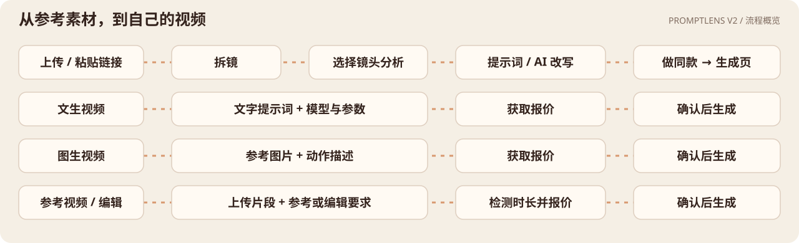
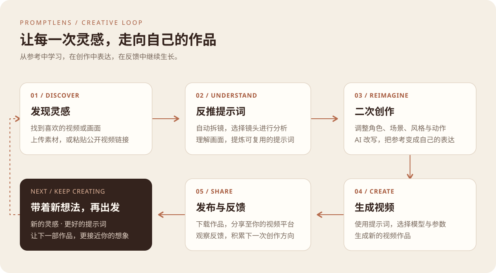

<p align="center">
  
</p>
<p align="center">从参考视频，到你的创作。</p>

PromptLens V2 是一个 AI 视频创作工作流工具，将参考视频或图片整理成可编辑的画面分析和复刻提示词，帮助你理解镜头、改写创意并生成自己的视频。

## 功能概览

- **参考素材分析**：上传视频、图片，或粘贴 TikTok、抖音、Bilibili 公开视频链接。
- **自动拆镜**：检测画面切换，生成带时间范围的镜头列表，支持预览和选择要分析的镜头。
- **逐镜头解读**：分析主体、角色、环境、动作、构图、运镜、光线、色彩和画面风格。
- **复刻提示词**：将画面信息整理成可复制、可编辑的视频生成提示词。
- **AI 改写与版本回看**：按文字要求修改单个镜头，保留版本，便于比较和继续调整。
- **做同款与视频生成**：将分析出的提示词带入生成页，支持文生视频、图生视频、参考视频生成和视频编辑。
- **项目与历史记录**：保存分析结果与生成记录；失败镜头可单独重试，已完成的镜头保留。

## V2 操作演示

从参考素材分析到视频生成的操作概览：



## 创作闭环流程

发现灵感、理解镜头、加入自己的创意，再生成和发布作品，让反馈成为下一次创作的起点。



## 使用方式

### 分析参考素材

1. 登录后进入「视频分析」。
2. 上传视频、图片，或切换到「粘贴链接」。
3. 视频可选择「拆镜分析」或「整段分析」，并选择分析模型。
4. 查看拆镜预览，勾选需要分析的镜头并提交。
5. 等待结果陆续返回，查看画面解读和复刻提示词。
6. 复制提示词、输入要求进行 AI 改写，或点击「做同款」。

图片作为单场景参考图分析，无需进行视频切镜。

### 生成视频

填写提示词，按需上传参考图片或视频，选择模型、画幅、分辨率、时长及数量后提交。可在页面查看任务进度和生成历史，完成后下载视频。

## 合作伙伴

<table>
  <tr>
    <td width="260" align="left">
      <a href="https://www.infistar.cc/register?aff=PROMPTLENS&amp;ref_source=link"></a>
    </td>
    <td>
      <a href="https://www.infistar.cc/register?aff=PROMPTLENS&amp;ref_source=link"><strong>无限星河 Infistar</strong></a> 是面向开发者与创作者的多模型 API 服务，覆盖文本、视觉、图像、音频和视频等常用 AI 能力。一个 API Key 即可按账户权限调用不同模型与线路，适合将模型能力接入应用、自动化工作流和创作工具。<br />
      在 PromptLens 中，你可以在「设置 → API Key 配置」保存 Infistar Key 并设为首选供应商；后续分析、改写和视频生成会按所选供应商与模型能力执行，历史任务仍保留原有来源。<br />
      <strong>通过 PromptLens 专属链接注册，可领取人民币 5 元 API 体验额度。</strong><br />
      <a href="https://www.infistar.cc/register?aff=PROMPTLENS&amp;ref_source=link">使用专属链接注册并领取体验额度 →</a>
    </td>
  </tr>
  <tr>
    <td width="260" align="left">
      <a href="https://kie.ai?ref=082d122f93c37c64ad05646afa7280bf">
        <picture>
          <source media="(prefers-color-scheme: dark)" srcset="public/partners/kie-brand-dark.png" />
          
        </picture>
      </a>
    </td>
    <td>
      <a href="https://kie.ai?ref=082d122f93c37c64ad05646afa7280bf"><strong>KIE</strong></a> 是面向开发者与创作者的多模型 API 平台，通过统一接口提供文本、图像、音频和视频模型。开发者可以在同一个账户中管理 API Key 和模型调用费用。<br />
      在 PromptLens 中，你可以在「设置 → API Key 配置」保存 KIE Key 并设为首选供应商，用于素材分析、提示词改写和视频生成。可用模型和参数以应用内的选项及账户权限为准。<br />
      <strong>KIE 新用户可领取 80 免费试用积分。</strong><br />
      <a href="https://kie.ai?ref=082d122f93c37c64ad05646afa7280bf">使用 PromptLens 专属链接注册 KIE →</a>
    </td>
  </tr>
</table>

在「设置 → API Key 配置」中分别管理 Infistar 与 KIE 密钥；新任务自动使用首选供应商，已提交的任务保留原供应商。不同供应商提供的模型和参数范围会有差异，可用性以当前 Key 的权限为准。配置页也提供[模真真模型价格与验真入口](https://mozhenzhen.com/go/prompt-lens)。

## 技术栈

- **应用**：Next.js 15、React 19、TypeScript
- **界面**：Tailwind CSS、shadcn/ui、lucide-react
- **数据与认证**：PostgreSQL、Drizzle ORM、better-auth
- **媒体存储**：Cloudflare R2
- **视频处理**：FFmpeg、ffprobe、PySceneDetect
- **AI 分析与视频生成**：Kie.ai, infistar等多模型聚合api厂商
- **测试**：Vitest、Playwright

## 本地开发

需要 Node.js 20+、pnpm、PostgreSQL，以及可用的媒体存储和模型服务配置。运行本地媒体 worker 还需要 FFmpeg、ffprobe；使用 PySceneDetect 检测时需要 Python 和 `scenedetect-headless`。

```powershell
pnpm install
Copy-Item .env.example .env.local
```

按 [.env.example](.env.example) 填写你自己的数据库、媒体存储和模型服务配置，并将所有本地真实配置统一保存在 `.env.local`。不要在仓库内保存 `.env`、环境快照或密钥备份；线上部署配置以对应 Vercel 项目的环境变量为准。示例使用 3001 端口，站点与认证地址需与实际端口一致。

配置完成后，对 `DATABASE_URL` 指定的数据库应用迁移并启动应用：

```powershell
node --env-file=.env.local node_modules/drizzle-kit/bin.cjs migrate
pnpm dev --port 3001
```

访问 [视频分析](http://localhost:3001/dashboard?tab=analyze) 或 [视频生成](http://localhost:3001/dashboard?tab=video-gen)。

使用本地媒体 worker 时，另开终端运行：

```powershell
powershell -NoProfile -ExecutionPolicy Bypass -File scripts/start-local-ffmpeg-worker.ps1
```

worker 配置与运行说明见 [FFmpeg Worker README](workers/ffmpeg-worker/README.md)。

## 项目结构

```text
prompt-lens/
├── app/                         # 页面与后端路由
├── components/workflow/         # 分析、改写与生成界面
├── lib/
│   ├── ai/                      # 模型调用与响应处理
│   ├── auth/                    # 用户认证
│   ├── db/                      # 数据库结构与查询
│   ├── ffmpeg-worker/           # 媒体 worker 客户端
│   └── workflow/                # 项目、镜头分析与提示词服务
├── workers/ffmpeg-worker/       # 视频检查、拆镜和素材提取
├── scripts/                     # 开发与评估脚本
├── docs/demos/                  # 操作演示素材
└── tests/                       # 自动化测试
```

## 自动拆镜的技术实现

<details>
<summary>展开查看候选切点检测、画面连续性校验、空白转场过滤、精确截取与逐镜头分析</summary>

拆镜由独立的媒体 worker 执行，主要使用 FFmpeg、ffprobe 和 PySceneDetect。Next.js 负责页面、项目管理和任务协调，媒体 worker 负责视频解码、镜头边界检测及素材提取。

### 1. 检查素材与视频流

本地上传和链接导入的视频保存后，会进入同一套视频预处理与逐镜头分析流程。worker 使用 `ffprobe` 读取时长、分辨率、帧率和音轨，并尝试解码真实画面，确认视频流可用。仅能读出分辨率不足以证明视频可以正常处理。

不支持的编码、无法解码的画面或损坏的视频会返回错误，避免将检测失败误当成「整段只有一个镜头」。

### 2. 检测画面切换

默认使用 **PySceneDetect 的 AdaptiveDetector**。它结合相邻帧的内容变化及附近帧的变化水平判断切点，适应不同片段的运动强度。检测结果是一组时间边界，用于把视频划分成连续区间。

当前默认参数：

| 参数 | 默认值 | 用途 |
| --- | --- | --- |
| 自适应阈值 | 3.0 | 控制画面变化达到什么程度时成为切点候选 |
| 最小内容变化值 | 15.0 | 过滤变化幅度较小的候选 |
| 邻域窗口 | 前后各 2 帧 | 提供局部变化水平作为比较依据 |
| 最小镜头间隔 | 0.6 秒 | 限制过于密集的切点 |

PySceneDetect 未启用或运行失败时，worker 回退到 **FFmpeg 的 scene filter**，默认阈值为 `0.32`。两种检测方式都失败时会报告拆镜失败；正常完成检测但没有发现切点时，视频可以作为一个连续片段继续处理。

### 3. 校验连续运动，减少误切

初次检测得到的是候选切点。后来增加的 `scene-refine.py` 会对 **PySceneDetect 和 FFmpeg 两条检测链路统一做二次校验**，降低重复帧、连续人物运动或快速画面变化造成的误切。

这一步在本地使用 OpenCV 和 NumPy 完成，不调用视觉大模型：

- 用 FFmpeg 逐帧解码为 **640 × 360** 的分析图，流式处理，不把整段视频帧保存在内存中。
- 在候选切点两侧比较画面差异及相关性，并对特征点进行**双向光流跟踪**。
- 只有图像高度相关、变化范围有限，且有足够多、分布在多个区域的可靠跟踪点时，才移除这个切点。仅有颜色或直方图相似不足以合并两个镜头。
- 例如当前连续性判断要求至少 30 个可靠跟踪点、可靠点比例不低于 65%，并覆盖 3 × 3 网格中的至少 5 个区域；这些条件需要与画面差异、相关性等检查同时成立。

精修是两条检测链路的必经阶段，失败会返回 `SCENE_DETECTION_FAILED`，避免通过再次回退绕过校验。它采用保守策略，不能保证消除所有误切。

### 4. 过滤纯黑、纯白空白转场

逐帧检查还会识别接近纯黑或纯白、确实没有可辨内容的画面，并从镜头区间中扣除相应时间段。判断同时考虑 **RGB 距离均值、方差与连通的前景标记**，避免仅凭平均亮度删除有内容的暗场或亮场。

- 带字幕、标题、标识或光源细节的黑白底画面，以及彩色纯色画面，按检测条件保留。
- 空白区间从**原始时间轴**上扣除，保留前后镜头之间的时间空隙，不压缩时间，也不把黑幕重新并入相邻内容。
- 空白边缘约 **0.12 秒**内的候选切点不再额外切出碎片，相关真实画面仍保留；过滤后短于 0.6 秒的有效内容也可保留。
- 自动拆镜后若全部为空白，返回 `NO_USEFUL_SCENES`，不继续创建分析报价或预留积分。用户主动选择「整段分析」时保留完整视频，不执行这套自动过滤。

分析图经过缩放，极小或极低对比度的内容仍有识别极限；这一机制用于过滤明确的空白转场，不承担语义内容审核。

### 5. 处理过长的连续片段

候选切点精修和空白过滤后，对保留下来的有效区间再进行时长检查：

- **15 秒以内的区间保留原有边界**。
- 超过 15 秒的区间继续细分，尽量让每段落在 **8–10 秒**。
- 无法按 8–10 秒完整覆盖时，围绕可行的平均长度分配时长，保持每段不超过 15 秒，避免留下很短的尾段。
- 分段连续覆盖各自的有效区间，不跨越已排除的空白时间；预览流程以源文件哈希作为种子，使同一素材的细分结果可复现。分段结果保存后，素材提取沿用同一组时间范围。

这一步用于控制单次分析的素材长度。新增的时间边界可能位于同一个连续镜头内，不能等同于检测到了新的剪辑切点。

### 6. 保持真实帧时间，精确截取素材

精修阶段使用 FFmpeg 输出的**整数 PTS × time_base**读取真实帧时间，不按固定帧率推算，也避免直接依赖精度有限的 `pts_time` 文本。区间以微秒精度保存，先返回镜头编号及起止时间，供用户预览和选择；正式分析沿用已保存的区间。

视频截取统一重编码，避免 GOP 流复制从更早的关键帧开始，带入区间外画面。结束位置按排他边界处理，在 `trim` 中减去 1 微秒并重置输出时间戳，减少取整后多带下一帧黑幕的问题。

- **视频片段**：按区间切出，分析流程中的片段编码为 H.264，存在音轨时使用 AAC。
- **代表帧**：在每段约 **10%、50%、90%** 的位置各提取一张 JPEG，覆盖片段前、中、后的画面。
- **音频**：存在音轨时尝试提取对应片段，供音频相关处理使用。

素材保存在 Cloudflare R2，后续分析复用这些资源。这里的三张代表帧是按时间采样的画面，与视频编码中的 I 帧概念不同。

### 7. 逐镜头准备素材与分析

当前自动拆镜默认使用逐镜头流水线：确认任务后先创建镜头占位与独立任务，**准备好一个镜头，就可以进入模型分析**，无需等待整条视频的所有素材提取完毕。准备与模型调用可以重叠进行，并受任务和供应商并发限制。

素材准备优先复用匹配同一用户、项目、媒体地址、源文件哈希和精确起止时间的缓存；片段与三张代表帧必须对应同一个镜头。未命中时只提取当前镜头，重试时复用已经保存的素材。单镜头素材请求设有超时，准备失败不会继续调用该镜头的模型，其他镜头可以继续。

所选镜头分别进入独立任务，可以并行分析，无需等待上一镜头的完整模型回答。模型主要接收三张代表帧、镜头编号和时间范围，输出结构化画面描述及复刻提示词；没有代表帧时才使用镜头视频作为视觉输入。

服务端检查 `story`、`visual`、`generationPrompt` 等结果字段，再保存分析内容。已完成镜头会陆续返回，页面按镜头编号展示，因此完成顺序可能与视频顺序不同。模型回答会先保存检查点，便于在后续写入暂时失败时恢复；失败镜头保留状态，可单独重试。

### 8. 缓存版本与结果恢复

- 自动拆镜预览使用 **`content-scenes-v3`** 版本，并核对 worker 返回的版本。升级后的同源请求不复用旧算法预览，已有预览及报价仍遵循原保留期和快照。
- 素材准备通过事务保存镜头媒体字段、父任务对应项及 `preparedAsset` 检查点，校验镜头归属和实际更新结果，减少并发写入覆盖素材地址的问题。
- 模型返回的答案先持久化，再提交正式结果；保存中断时优先恢复已有答案，避免仅因写入失败再次调用模型。执行租约与幂等提交控制并发恢复。
- 结果页优先展示已保存片段；片段缺失而源视频仍可用时，可按本镜头原时间区间预览。区间预览不会冒充已生成的独立片段。

### 适用范围与局限

- 自动拆镜适合包含多个画面切换的视频；整段分析适合完整的单镜头片段。
- 连续性精修可以减少部分运动误切，空白过滤可以排除明确的黑白转场；快速运镜、闪光、渐变转场或变化很小的剪辑仍可能造成误切或漏切，检测结果需结合预览判断。
- 三帧采样提供主要视觉参考，可能遗漏采样点之间的短暂动作。分析内容和提示词适合继续编辑与校正。
- 媒体处理与模型分析是不同阶段：成功拆出镜头后，模型调用仍可能受到服务可用性和网络状况影响。

相关实现：[候选切点检测](workers/ffmpeg-worker/scene-detect.py)、[连续性校验与空白过滤](workers/ffmpeg-worker/scene-refine.py)、[区间校验、长片段分段与代表帧采样](workers/ffmpeg-worker/scene-segments.mjs)、[媒体 worker](workers/ffmpeg-worker/server.mjs)、[素材复用与保存](lib/billing/scene-assets.ts)、[独立镜头任务与恢复](lib/billing/independent-scene-analysis.ts)、[模型分析](lib/workflow/scene-analysis.ts)。

优化背景与已有验证记录见 [ADR 0053](docs/decisions/0053-content-aware-scene-refinement.md)，逐镜头流水线见 [ADR 0016](docs/decisions/0016-v2-progressive-scene-preparation-and-result-delivery.md)。这些记录针对具体素材和测试条件，不代表所有视频的通用准确率。

</details>

## License

MIT

## Star 趋势

[](https://www.star-history.com/?repos=raojiacui%2Fprompt-lens&type=date&legend=top-left)

## 请勿刷 Star 或 Fork

请不要使用机器人、脚本、批量账号或刷星服务给本仓库添加 Star 或 Fork。

欢迎真实用户因兴趣或使用需要自愿 Star、Fork，也欢迎反馈问题、分享使用体验和贡献代码。感谢每一份真实的支持。

Please do not use bots, scripts, bulk accounts, or paid services to inflate this repository's stars or forks, including unsolicited promotion. Genuine interest, feedback, and contributions are welcome.
